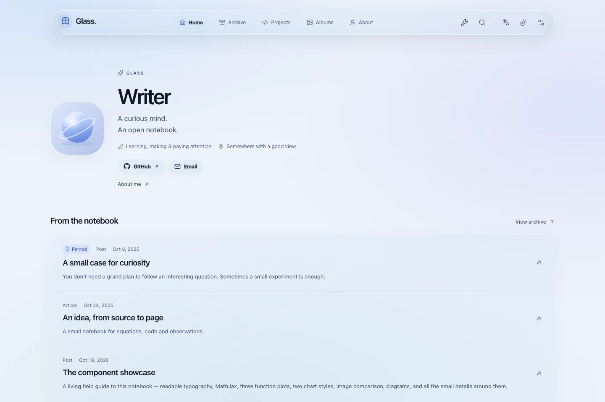
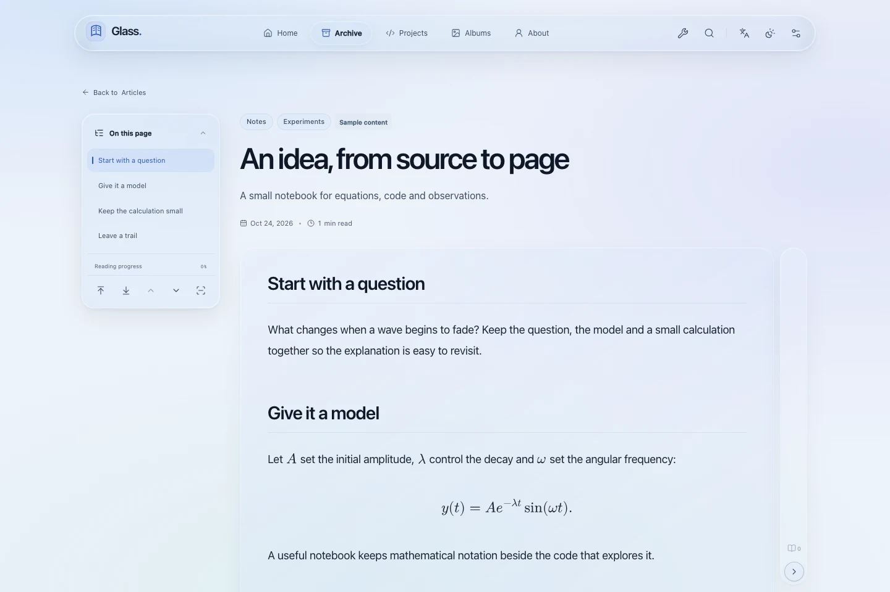
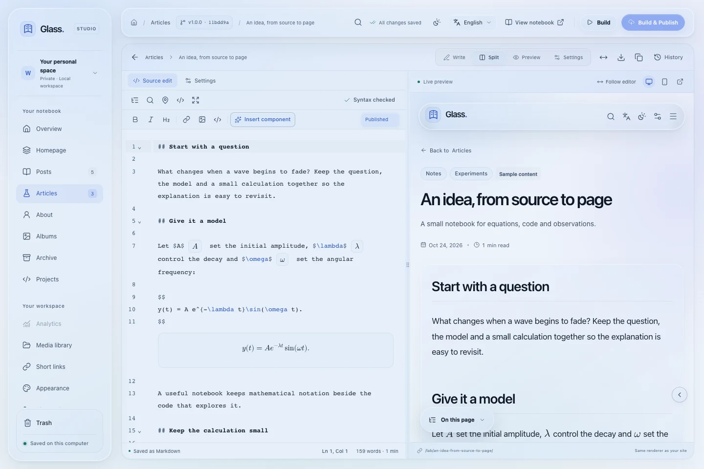

# Glass

**A personal publishing space, built around Markdown.**

Glass brings a Liquid Glass interface, a capable writing studio and a custom static engine into one blog. Write locally or in a private Cloudflare-hosted Studio. Publish complete HTML pages with readable typography, build-time mathematics and diagrams, and interactions that load when readers need them.

[Showcase](#showcase) · [Run locally](#run-locally) · [Host on Cloudflare](#host-on-cloudflare) · [Documentation](#documentation)

## Showcase

These screenshots use the generic Glass demo and its sample content. The Studio images come from a local demo workspace.

### A homepage with room to breathe

<picture>
  <source media="(prefers-color-scheme: dark)" srcset="docs/images/showcase/home-dark.webp">
  
</picture>

Introduce yourself, choose the writing to pin, and let recent posts fill the rest. Projects, the archive, albums and About have their own destinations. A visual-chapter homepage is also available.

### A reading surface for words, code and ideas

<picture>
  <source media="(prefers-color-scheme: dark)" srcset="docs/images/showcase/reading-dark.webp">
  
</picture>

Keep the article in one continuous flow. Floating navigation, footnotes, annotations, focus mode and reader preferences support longer reading; image viewing and interactive components add detail where it helps.

### A studio that stays close to the source

<picture>
  <source media="(prefers-color-scheme: dark)" srcset="docs/images/showcase/studio-dark.webp">
  
</picture>

Edit ordinary Markdown with CodeMirror completion, syntax highlighting, linting, previews, search, an outline and a minimap. Compare revisions, manage media and publish from the same workspace.

## What you can make

| Area               | Included                                                                                                                          |
| :----------------- | :-------------------------------------------------------------------------------------------------------------------------------- |
| Essays and notes   | Headings, task lists, footnotes, highlights, callouts, disclosures, tabs, citations and booktabs-style tables.                    |
| Technical writing  | MathJax 4, optional STEM notation packages, Expressive Code, pseudocode, Mermaid diagrams, mindmaps, plots and charts.            |
| A personal website | Curated homepages, a chronological archive, project cards, photo albums, About and configurable collection names and paths.       |
| Reader tools       | Pagefind full-text search, light/dark appearance, reading controls, saved reading, an image viewer, sharing and print styles.     |
| Daily authoring    | Image preparation, media usage checks, batch operations, Trash, revisions, portable backups, short links and optional scheduling. |
| Optional services  | Giscus conversations and annotations, R2 media delivery, Cloudflare/Google analytics and the independent private ACA dashboard.   |

The interface supports English, Simplified Chinese and Traditional Chinese. External writing tools can use the versioned authoring pack and draft-scoped MCP interfaces.

## Run locally

Requires **Node.js 22.17 or newer** and npm.

```sh
git clone https://github.com/Lapotron/Glass.git
cd Glass
npm ci
npm run renderers:install
npm run dev
```

Open the [blog](http://127.0.0.1:4310/) or [Studio](http://127.0.0.1:4310/studio/). Start with **About**, **Homepage** and **Appearance**, then replace the sample writing and illustrations. Your Markdown, JSON settings and media live in `content/`.

Build a standalone reader artifact with:

```sh
npm run build
npm run preview
```

Public output goes to `dist/`. Only published content enters the site, feeds and search. Article mathematics, diagrams and syntax highlighting are compiled before publication; reader JavaScript enhances the finished pages.

## Host on Cloudflare

The [dashboard deployment guide](docs/hosted-studio.md#dashboard-only-deployment) walks through GitHub-connected Workers Builds, custom domains, Cloudflare Access and private D1/R2 storage. Hosted authoring needs a browser and does not require a local server.

- **Studio Worker:** the private editor, authoring APIs and job coordinator, protected by Access.
- **D1 and private R2:** the notebook manifest, content bytes, history and recovery data.
- **Cloudflare Pages:** the public static website, generated only when you choose Publish.
- **One Studio Workers Builds pipeline:** Git pushes update Studio; an exact Publish request runs the Node static compiler and Pages Direct Upload.

Names, domains, bindings and the production branch are configurable. Git pushes update application code; Studio publication approves the notebook release. Follow the guide's setup order and preserve the encryption key when updating an existing installation.

Editing, uploads, browser previews, history, backups and imports use direct private storage APIs without CI. Snapshots share immutable media blobs; portable exports leave out generated artifacts and caches. Hosting includes storage totals, retention, safe cleanup and seven-day recovery for deleted history.

Local Studio also retains [Cloudflare Pages Direct Upload](docs/publishing.md). Optional ACA and the [isolated Vinext prototype](docs/dynamic-prototype.md) have their own infrastructure; Vinext is an evaluation app.

## Documentation

| Start here        | Read more                                                                                                                                    |
| :---------------- | :------------------------------------------------------------------------------------------------------------------------------------------- |
| Writing           | [Markdown reference](docs/markdown-reference.md) · [Editor workspace](docs/editor-workspace.md) · [Authoring and MCP](docs/mcp-authoring.md) |
| Technical content | [Math](docs/math-authoring.md) · [Pseudocode](docs/pseudocode.md) · [Diagrams](docs/diagrams.md) · [Charts](docs/charts.md)                  |
| Site management   | [Settings](docs/site-settings.md) · [Media](docs/media.md) · [Studio operations](docs/studio-operations.md) · [Recovery](docs/recovery.md)   |
| Hosting           | [Hosted Studio](docs/hosted-studio.md) · [Pages publishing](docs/publishing.md) · [ACA](docs/aca.md)                                         |
| Development       | [Contracts](docs/contracts.md) · [Design system](docs/design-system.md) · [Production performance](docs/production-performance.md)           |

## Development checks

```sh
npm run check
npm run lint
npm test
npm run build
npm run build:console
npm run skills:check
npm run test:browser
```

Browser tests use temporary notebooks. Install Chromium and WebKit once with `npx playwright install chromium webkit`. Hosted checks use `npx playwright test --config playwright.cloud.config.ts`. The optional Vinext app has its own installation and security suite, described in its guide.

Glass retains the `fieldnotes-markdown/1` dialect and portable notebook formats for compatibility. Generated output, local history, credentials and dependencies stay outside version control.

## License

[MIT](LICENSE), copyright Lapotron. Dependencies and included geographic imagery retain their own terms; see [third-party notices](NOTICE.md).
