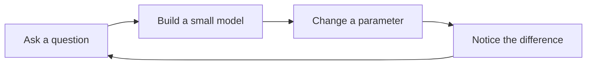

A wave is a pattern of change. From sound and light to a ripple in a pond, the same simple mathematics keeps appearing.

## Start with a sine

We can describe a wave with two parameters:

$$
y(x) = A \sin(\omega x)
$$

Here, $A$ is the **amplitude** and $\omega$ is the **angular frequency**. Try changing each one below.

```interactive
{"type":"function-plot","title":"Make a little wave","preset":"sine","amplitude":1.5,"frequency":1,"caption":"Drag a slider. Notice that amplitude changes the height, while frequency changes the number of cycles."}
```

## What stays the same?

Changing the amplitude stretches the wave vertically, but its zeros remain in the same places. Changing the frequency compresses or stretches it horizontally.

The period is the distance between repeating points:

$$
T = \frac{2\pi}{\omega}
$$

## From a question to a model

An experiment starts with a question and ends with another, slightly better one.



```typescript
// A small idea
```


_Demonstration experiment. The controls and equations work entirely in your browser._

$$
\int^{1}_{0}
$$
