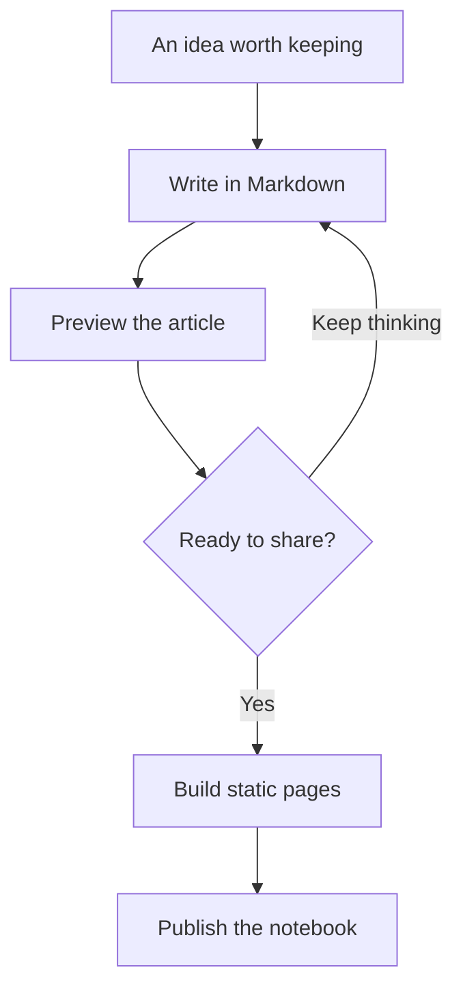
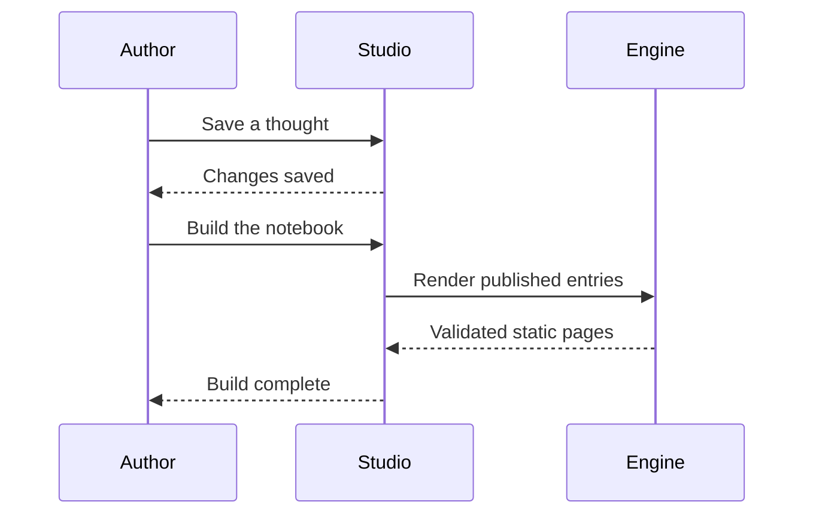

This page is a small tour of everything an article can contain. Read it slowly, move a slider, open a data table, or jump between sections with the floating outline. Each example is real: the equations are typeset, the plots respond, and the code can be copied.

The illustrations and datasets are demonstration material. The page is also a useful starting point for a new essay, experiment, or technical note.

## A page made for reading

Good typography gives an idea somewhere to settle. **Strong text** creates emphasis, *italics* add a quieter voice, and ~~an abandoned thought~~ can remain visible without competing with the next one. An inline expression such as `const curiosity = true` belongs comfortably inside a sentence.

A link can take you to [a small case for curiosity](/blog/a-small-case-for-curiosity/), a related [wave experiment](/blog/component-showcase/#a-sine-wave), or the [complete archive](/archive/). The surrounding interface uses the same accent, materials, and light or dark appearance as the article.

> Give the important things somewhere to breathe. A reading surface should make the words easier to follow, while the controls stay close enough to help.

### A smaller heading

Third-level headings appear as nested items in the floating outline. They are useful when a section contains several related ideas.

#### A quiet fourth level

Fourth-level headings stay in the article itself. The outline concentrates on the larger structure so that it remains useful on a small screen.

## A window of Liquid Glass

A floating control has a different job from a reading surface. Its edge catches the light, the background bends through the lens, and the words above it stay sharp. The grid behind this specimen makes that refraction easier to see. Move the pointer across the glass to change its highlight.

<div class="material-playground">

<div class="material-grid" aria-hidden="true"></div>
<div class="liquid-lens liquid-clear material-demo-lens">
<span class="material-eyebrow">A little light</span>
<h3>Light, with a little depth.</h3>
<p>Follow the light around the edge and the grid through the lens. The text stays on its own clear layer.</p>
<a href="/archive/">Explore the archive ↗</a>
</div>
</div>

Navigation, the floating outline, and Studio controls share this material system. Full edge refraction is available in Chromium browsers; other browsers retain the highlights, tint, depth, and backdrop blur. Reduced transparency replaces the optical layer with a solid surface.

## Equations, already typeset

Inline mathematics stays in the flow of the paragraph: if $f(x)=x^2$, then $f'(x)=2x$. Display equations have more room:

$$
\int_0^1 x^2\,\mathrm{d}x
= \left[\frac{x^3}{3}\right]_0^1
= \frac{1}{3}.
$$

Aligned expressions make a short derivation easier to scan:

$$
\begin{aligned}
y(x) &= A\sin(\omega x), \\
\frac{\mathrm{d}y}{\mathrm{d}x} &= A\omega\cos(\omega x), \\
\frac{\mathrm{d}^2y}{\mathrm{d}x^2} &= -\omega^2 y(x).
\end{aligned}
$$

Matrices and piecewise functions work too:

$$
R(\theta)=
\begin{bmatrix}
\cos\theta & -\sin\theta \\
\sin\theta & \cos\theta
\end{bmatrix},
\qquad
g(x)=\begin{cases}
x^2, & x\geq 0,\\
-x, & x<0.
\end{cases}
$$

These formulas are rendered to SVG during the static build. They remain visible when browser JavaScript is disabled; the TeX source supplies an accessible label.

## Three functions to explore

All three plots share a keyboard-operable pair of sliders and a Reset button. Select a slider and use the arrow keys for small adjustments. The horizontal domain is $[-2\pi,2\pi]$; all quantities here are dimensionless.

### A sine wave

For $y=A\sin(\omega x)$, amplitude changes the height and frequency changes the number of oscillations. Set $A=1.5$ and $\omega=2$ to compare a taller, more tightly spaced wave.

```interactive
{
  "type": "function-plot",
  "title": "A wave, shaped by you",
  "preset": "sine",
  "amplitude": 1.5,
  "frequency": 1,
  "caption": "Move Amplitude or Frequency, then use Reset to return to the starting wave."
}
```

### A Gaussian curve

This preset draws $y=Ae^{-(\omega x)^2/2}$. Increasing the frequency parameter narrows the curve. Its peak stays at $x=0$ and has height $A$.

```interactive
{
  "type": "function-plot",
  "title": "A softer shape",
  "preset": "gaussian",
  "amplitude": 2,
  "frequency": 0.8,
  "caption": "Try a larger frequency: the bell becomes narrower while its peak stays in place."
}
```

### A polynomial

The third preset draws $y=A[(x/\pi)^3-\omega x/\pi]$. Here the frequency slider adjusts the linear term; it is a shape parameter rather than a period. Parts of the curve outside the plot's vertical window are clipped.

```interactive
{
  "type": "function-plot",
  "title": "A curve with turning points",
  "preset": "polynomial",
  "amplitude": 1,
  "frequency": 1.4,
  "caption": "Explore how the balance between the cubic and linear terms changes the turning points."
}
```

## Data, drawn two ways

The following charts use the same invented dataset: minutes spent reading and making over six days.[^data] Select a legend item to hide or reveal a series. Open **View data table** for the exact values.

### Follow a line

```interactive
{
  "type": "chart",
  "title": "A few minutes, each day",
  "style": "line",
  "labels": ["Mon", "Tue", "Wed", "Thu", "Fri", "Sat"],
  "series": [
    { "name": "Reading", "values": [12, 18, 15, 28, 24, 38] },
    { "name": "Making", "values": [8, 12, 23, 20, 32, 27] }
  ],
  "caption": "Illustrative minutes per day. Toggle Reading or Making to focus on one series."
}
```

### Compare the bars

```interactive
{
  "type": "chart",
  "title": "The same observations, as bars",
  "style": "bar",
  "labels": ["Mon", "Tue", "Wed", "Thu", "Fri", "Sat"],
  "series": [
    { "name": "Reading", "values": [12, 18, 15, 28, 24, 38] },
    { "name": "Making", "values": [8, 12, 23, 20, 32, 27] }
  ],
  "caption": "A different view of the identical sample data, with a complete table below."
}
```

## Two moments, one landscape

An image comparison lets one scene carry two versions. Drag the handle across this illustrated coastline, or focus the vertical divider and use the arrow keys.[^images]

```interactive
{
  "type": "image-compare",
  "title": "From first light to blue hour",
  "before": "/media/coast-dawn.svg",
  "after": "/media/coast-dusk.svg",
  "beforeLabel": "First light",
  "afterLabel": "Blue hour",
  "caption": "Original landscape illustrations. Move the divider to compare the palettes."
}
```

## Diagrams that explain

A diagram can show relationships more quickly than another paragraph. This flowchart follows an idea through writing, preview, and publication:



A sequence diagram gives the same process a sense of time:



Diagrams load when needed. If enhancement is unavailable, their readable source remains in the page.

## Code with room to breathe

Code blocks have language labels, syntax highlighting, and a Copy code button. Long lines scroll within the block instead of pushing the article off the screen.

```typescript
type Observation = {
  day: string;
  minutes: number;
};

const totalMinutes = (week: Observation[]) =>
  week.reduce((sum, observation) => sum + observation.minutes, 0);

const week = [
  { day: 'Monday', minutes: 12 },
  { day: 'Tuesday', minutes: 18 },
];

console.log(totalMinutes(week)); // 30
```

```python
from math import sin, pi

def sample_wave(amplitude=1.0, frequency=1.0, count=9):
    return [
        (x := -2 * pi + 4 * pi * i / (count - 1), amplitude * sin(frequency * x))
        for i in range(count)
    ]
```

To add an interactive component, insert a fenced block named `interactive` with its JSON configuration. A code fence named `json` displays the configuration as ordinary code instead:

```json
{
  "type": "function-plot",
  "title": "A little wave",
  "preset": "sine",
  "amplitude": 1,
  "frequency": 1
}
```

## Images and small details

A regular image needs no interactive wrapper. Descriptive alternative text explains the scene when the image cannot be seen.


*First light. The same local illustration used in the comparison above.*

<details>
<summary>Open a quieter note</summary>

This disclosure uses the browser's native control. Open it with a click, or focus its summary and press Enter. It works without JavaScript, making it useful for an optional explanation or a short aside.

</details>

---

A horizontal rule marks a change of pace without adding another heading. Footnotes keep supporting details nearby without interrupting the sentence.[^data]

## Tables and checklists

Every interactive component starts with something useful in the generated HTML:

| Component | What you can explore | Static fallback |
| --- | --- | --- |
| Function plot | Sine, Gaussian, polynomial | Generated SVG curve |
| Line chart | Series visibility and values | SVG and data table |
| Bar chart | Series visibility and values | SVG and data table |
| Image comparison | The boundary between two images | Both local images |
| MathJax | Inline and display notation | Typeset SVG formulas |
| Mermaid | Flowcharts and sequence diagrams | Readable diagram source |

A short checklist can make the next step clear:

- [x] Give the page a useful title and summary.
- [x] Check the formulas and illustrative data.
- [x] Try the controls with the keyboard.
- [ ] Replace the sample material with an idea of your own.

An ordered list gives a process a beginning and an end:

1. Write the idea in ordinary Markdown.
2. Add an equation, image, or component where it helps.
3. Preview the page in light and dark appearance.
4. Build the static notebook when it is ready.

## The interface around the words

The floating outline tracks your current section and shows reading progress. On a narrow screen it becomes a compact control at the bottom right. The top navigation provides search and an appearance switch; the layout, formulas, code, and widgets adapt to the available width.

Glass supplies a little depth around the controls, while the reading surface keeps the text stable. Reduced motion and solid-material preferences have corresponding fallbacks. Typography, accent color, and materials share the same settings across the public notebook and the local Studio.

## A starting point for your own page

This showcase is editable in Studio alongside the other writing. Reuse a section, keep the components that explain something, and remove the rest. A good article rarely needs every component at once.

Continue with [the wave experiment](/blog/component-showcase/#a-sine-wave), visit the [photo journal](/life/), browse the [archive](/archive/).

[^data]: All chart values are invented demonstration data, expressed in minutes. They are not a record of anyone's habits or a research result.
[^images]: The coastline images are original sample illustrations included with this notebook. They are not photographs of a personal trip.

## A question, with immediate feedback

A small check can make an explanation more active. Choose an answer, compare your reasoning, or open the explanation directly. The question remains usable without JavaScript.

```interactive
{
  "type": "quiz",
  "title": "What changes the wave?",
  "prompt": "Which parameter changes the number of oscillations in a fixed interval?",
  "choices": [
    "Amplitude",
    "Frequency",
    "A constant vertical shift"
  ],
  "answer": 1,
  "explanation": "Frequency controls how quickly the pattern repeats. Amplitude controls its height, and a constant shift moves it up or down.",
  "caption": "Choose a response and check it. Reset to try the question again."
}
```

## Several views of the same idea

Tabs can hold complementary explanations without interrupting the article’s continuous reading surface. Use the arrow keys, Home, or End to move between views. With JavaScript off, every view is displayed in order.

```interactive
{
  "type": "tabs",
  "title": "From intuition to experiment",
  "tabs": [
    {
      "label": "Intuition",
      "body": "A wave repeats a pattern. Amplitude describes its height, while frequency describes how often the pattern repeats."
    },
    {
      "label": "Try it",
      "body": "In the plot above, move one parameter at a time. Describe the expected change before touching the slider, then compare your prediction with the curve."
    },
    {
      "label": "Reflect",
      "body": "Reset the plot and explain the difference in your own words. A useful explanation connects the parameter to the visible behavior."
    }
  ],
  "active": 0,
  "caption": "One idea, three approaches. Every panel has a useful static fallback."
}
```

## A richer Markdown vocabulary

These components are written directly in Markdown. They stay inside this page’s continuous reading surface and use the same typography, accents, and materials as the rest of the notebook.

> [!NOTE]
> A note belongs close to the idea it explains. It can contain **emphasis**, links, and $a^2+b^2=c^2$.

> [!TIP]
> Open any photograph with a click, then zoom, pan, or move through the collection.

> [!IMPORTANT]
> Keep a discussion’s explicit key when changing its title. That key preserves the conversation.

> [!WARNING]
> A good warning explains what needs attention without interrupting the whole article.

> [!CAUTION]
> Image edits create a new public copy. Your retained original stays in the private Studio workspace.

:::details[Why use a disclosure?]
A short article can offer deeper context without requiring everyone to read it.

- Lists remain ordinary Markdown.
- An equation such as $\int_0^1 x\,dx=\frac12$ uses the same MathJax renderer.
- Keyboard users can expand this section with Enter or Space.
:::

### Questions and conversations

::::discussion[What makes an interface feel calm?]{#a-calm-interface comments="true"}
Good spacing, predictable controls, and a clear hierarchy all contribute. A useful discussion can begin with a question and a provisional explanation.

:::question[Should every paragraph be a card?]
How much visual structure does a long-form article need?
:::

:::answer[Let the prose flow]
Keep the article in one reading surface. Use explicit components where they explain something, and let typography carry the rest.
:::
::::

### Two perspectives

::::tabs
:::tab[An explanation]
**Refraction** describes a change in light’s direction as it moves between materials. Snell’s law gives a compact relationship:

$$n_1\sin\theta_1=n_2\sin\theta_2.$$
:::

:::tab[A small example]
For air and water, the light bends toward the normal when it enters the denser medium.

```typescript title="A ray entering water" {2-3}
const incidentAngle = Math.PI / 6;
const ratio = 1 / 1.33;
const refractedAngle = Math.asin(ratio * Math.sin(incidentAngle));
```
:::
::::

### A sequence worth following

:::steps
1. **Observe.** Find a question worth staying with.
2. **Experiment.** Change one thing and see what happens.
3. **Reflect.** Describe the result, including what surprised you.
:::

### Pictures with room to breathe

:::figure[The same coastline, in the quiet light before sunrise.]

:::

:::gallery


:::

### Small typographic tools

Refraction
: A change in the direction of light as it crosses a boundary between materials.

Reflection
: Light returning from a surface rather than passing through it.

Use :mark[a little emphasis] where a detail matters. Press :kbd[⌘K] to search. An :abbr[SVG]{title="Scalable Vector Graphics"} remains sharp as it grows. Chemistry uses H:sub[2]O, while simple powers can appear as x:sup[2].

::link-card[Continue through the archive]{href="/archive/" description="Writing and experiments, collected over time."}
