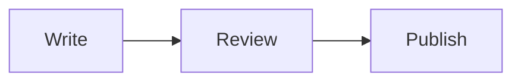
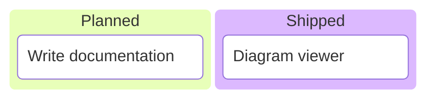
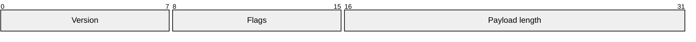
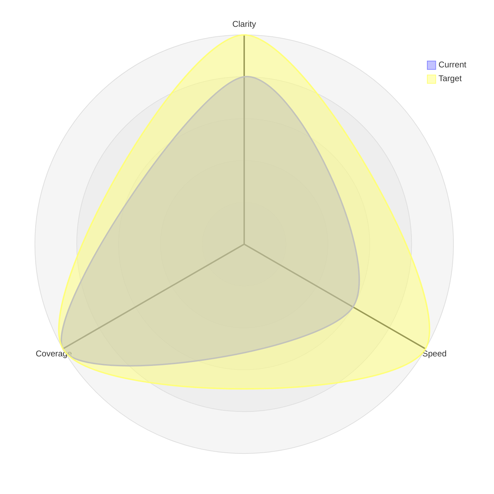
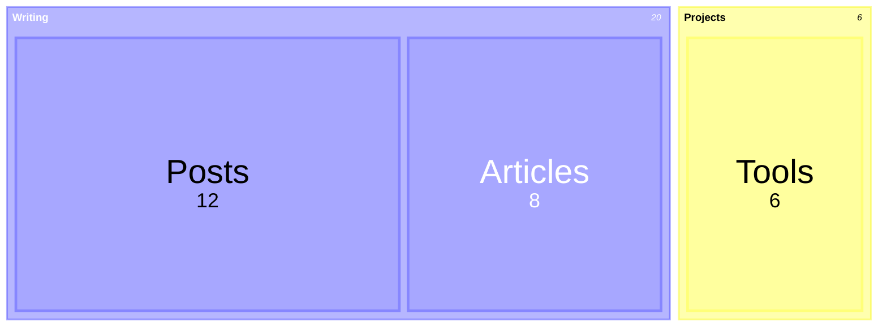
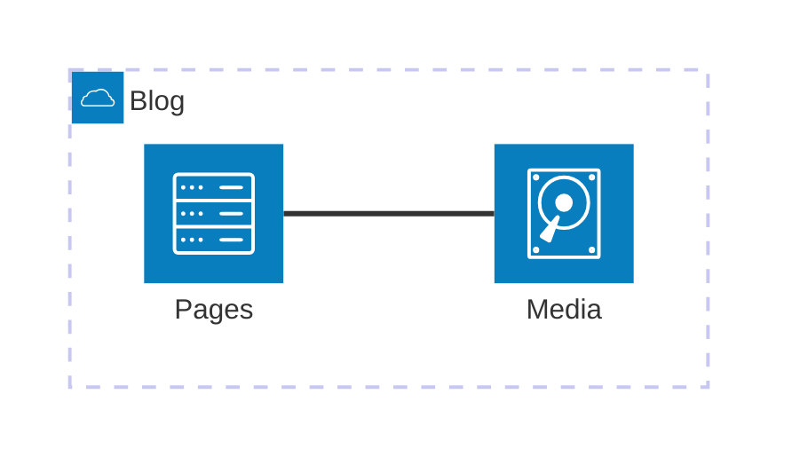
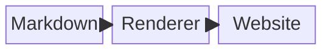
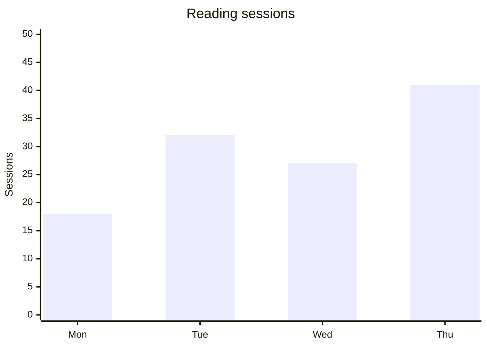
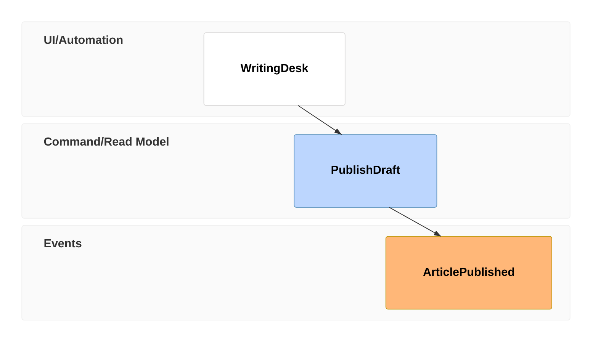

Mermaid 12.2.0 compiles these self-contained examples to transparent light/dark SVG. Add accessible titles/descriptions when adapting them. The default node treatment stays quiet; authored colors and data encodings are retained. Read diagrams.md in the authoring pack for the viewing and export contract.

## Flowchart



## Kanban



## Packet



## Radar



## Treemap



## Architecture



## Block diagram



## XY chart



## Swimlanes

```mermaid
swimlane-beta LR
  subgraph Author
    Write[Write draft]
  end
  subgraph Reader
    Read[Read article]
  end
  Write --> Read
```

## Use case

```mermaid
usecase-beta
direction LR
actor Reader
systemBoundary Blog
  Read("Read an article")
end
Reader --> Read
```

## Tree view


## Event modeling


