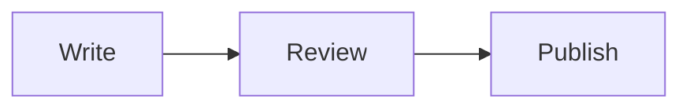

# Mermaid diagrams

Glass pins Mermaid **12.2.0**, verified against npm's `latest` tag on 2026-10-23. The complete local bundle renders diagrams during builds and Studio previews. Readers receive SVG, not Mermaid or a browser compiler. When upgrading, check the [upstream release](https://github.com/mermaid-js/mermaid/releases), update the exact dependency and shared authoring version together, and rerun the modern-family and security tests. Builds themselves do not contact npm.

## Authoring and presentation

Use a `mermaid` fence with ordinary Mermaid syntax. Add `accTitle` and, where supported, `accDescr` for a useful accessible name and description. An authored title becomes a quiet caption; a generic “Diagram” heading is omitted.

````markdown

````

The entire figure, its SVG canvas and preview wrapper are transparent and unframed. Default structural nodes have very faint fills, thin rims and normal-weight text using the site's configured reading family. Diagrams stay sharp inside the continuous article reading surface. Only the small controls use the shared Liquid Glass material; the optical runtime must not distort the drawing or add a surrounding card.

Explicit `classDef`, node styles and meaningful categorical colors remain authored. Default material styling targets structural boxes rather than clearing every rectangle or recoloring data marks. Pie/radar/treemap and other data encodings retain distinct colors. Reduced transparency gives default structural boxes a solid contrast fallback while retaining the clear figure canvas. Source Markdown is never rewritten by theme changes.

Both themes compile from Mermaid's customizable `base` theme with matching geometry and the same resolved presentation. Site reading font/scale and foreground-role changes participate in renderer and component-preview cache identities. Reader appearance switches select the existing light/dark SVG; they never compile Mermaid again.

## Viewing and export

Click a diagram or use **View diagram** to open the shared native-dialog/PhotoSwipe viewer. Article and full-preview galleries contain only Mermaid diagrams, in document order. Photos retain their separate gallery. A source component preview opens that single drawing, with no navigation controls for an absent second item.

Viewer slides contain SVG directly: normal zoom, fit, actual size, pinch/pan and fullscreen remain sharp, with native rich labels and MathML intact. Zoom reaches at least twice intrinsic size, or eight times fit when greater. Diagram sessions inherit the reading theme, while normal photo sessions keep their existing dark stage. Every viewer clone and cached Studio occurrence gets independent IDs, including CSS/marker/clip-path and accessible-label references.

**Download SVG** exports the current theme with a transparent canvas and self-contained styles. It does not upload a new media item or create an R2 object. Public **Copy diagram link** uses the canonical article plus the generated diagram fragment. Standalone Studio previews omit that action. Information shows diagram dimensions/format and caption instead of EXIF or camera warnings.

Only compiler-produced inline drawings use this vector path. Arbitrary remote SVGs retain the existing image-loader/download restrictions. Variants serialize on intent for active/nearby slides, with a 1 MiB limit per variant; download object URLs are released after the download window. Closing cancels deferred work and restores the activating control, including above another Studio dialog. A viewer failure leaves the original inline drawing and source available.

## Source editing and modern syntax

The article editor and Mermaid component dialog use a lightweight incremental CodeMirror highlighter for declarations, labels, identifiers, arrows, keywords, numbers, comments and configuration. It does not load Mermaid or validate a whole diagram on each keystroke. The private production renderer remains the syntax authority. The component dialog keeps a local undo history; applying source to the article retains the existing captured-source conflict check and single undoable replacement.

The published **View Mermaid source** disclosure uses build-time Expressive Code/Shiki highlighting and the existing copy/download controls. Exact source remains recoverable; highlighting is separate from rendering.

The full bundle accepts its registered diagram types without an application whitelist. Reviewed examples cover flowcharts, Kanban, packets, radar, treemap, architecture, block/XY charts, swimlanes, use cases, tree views and event modeling. See [the generated examples](authoring-templates/mermaid-diagrams.md). Optional external icon packs/plugins still require explicit local registration; diagrams cannot fetch remote fonts, images or icon services.

## Rendering and verification

Canonical source is limited to 50,000 characters and Mermaid's 500-edge bound; compilation is serialized, locally network-blocked and bounded to 15 seconds. Sanitization, deterministic per-occurrence IDs, native MathML and last-successful build behavior remain authoritative. The private checksum cache includes source, implementation, bundle, platform and presentation; new rendering contracts invalidate old results.

Review both themes over wallpaper, 320px layouts, larger reading text, reduced transparency/motion, source and full previews, repeated diagrams, native math, standalone SVG downloads and paper output. Print retains the complete light drawing and hides viewer controls/source disclosures. Use temporary notebooks for browser verification; do not rewrite the author's samples to test presentation changes.
