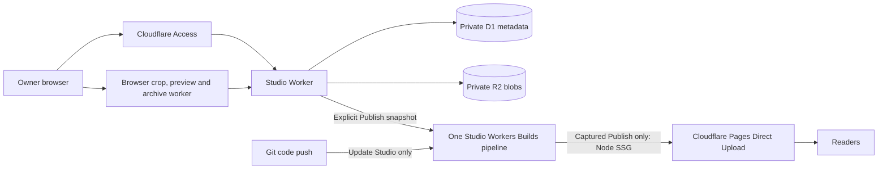

# Hosted Glass Studio

Glass uses a private authoring platform and a generated public site. You do not need a local server for hosted authoring.

Starting over or deploying for the first time? Use the [fresh Cloudflare installation checklist](hosted-studio-clean-install.md), including backup-before-deletion, dashboard fields, credential placement and final verification.

## Architecture



- **Studio** authenticates every private page, API, media request and authoring tool through Access JWT verification and owner allowlisting. Mutations require the same-origin Studio CSRF token.
- **D1** stores paths, hashes, revisions, leases, snapshots and operation state. **Private R2** stores immutable file bytes. Connection and service settings use the existing Studio encryption key.
- Routine saves, image/file uploads, crop/resize, source checks, backups, history operations and migration do **not** start CI. Large batches stage bounded requests before one compare-and-swap activation.
- Browser previews and image preparation remain private. Prepared images use WebP, or lossless PNG when the browser cannot encode WebP. Unsupported image codecs/animation produce an explicit error; they do not queue a build or silently flatten an animation. Originals remain private. The Node production compiler owns production MathJax, Mermaid, syntax highlighting, responsive images and Pagefind.
- **Publish** captures an immutable release and starts the Studio pipeline. That exact build UUID runs SSG and uploads to **Pages**. It does not redeploy Studio. A Git push builds/deploys Studio and never creates a public release.
- Pages contains published reader output and its optional annotation adapter. It has no private D1/R2 bindings or Studio secrets. The optional public-media CDN bucket is separate from the private notebook bucket.

Explicit ACA infrastructure setup/deployment, reviewed rollback and public-CDN scans, protection-rule changes and reviewed cleanup retain a separate captured maintenance mode in the same pipeline. This mode performs no SSG, public-site deployment or Studio redeployment; ACA reports, version reads, Search Console imports and connection checks remain direct.

Local authoring and local Pages publication remain supported. Canonical Markdown/JSON formats are unchanged.

## Dashboard-only deployment

Assume the repository is `Lapotron/Glass`, or your own fork. Choose your own names and copy real resource IDs from Cloudflare.

| Resource        | Example               | Purpose                                          |
| --------------- | --------------------- | ------------------------------------------------ |
| Studio Worker   | `glass-studio`        | Private console and native APIs                  |
| D1 database     | `glass-studio`        | Private metadata                                 |
| R2 bucket       | `glass-private`       | Private bytes, originals and recovery references |
| Pages project   | `glass-blog`          | Public Direct Upload SSG output                  |
| Studio hostname | `console.example.com` | Owner-only Access application                    |
| Public hostname | `example.com`         | Attach to Pages after staging verification       |

A single Git-connected Worker is sufficient. Do not create a second reader Worker for a new installation. Leave the R2 bucket’s public domains and `r2.dev` disabled. No S3 key pair is needed for the private Worker binding.

### 1. Create private resources

In the Cloudflare dashboard, create a D1 database and a Standard R2 bucket. Record the account ID, database UUID, bucket name and chosen Worker name. Existing installations must preserve these resources, their identities and all data.

### 2. Protect the whole Studio hostname

In Zero Trust → Access controls → Applications, create a self-hosted application for the **whole hostname**, without `/studio/`. Allow only the owner email. Record the Access team name and application AUD. Keep the browser owner-login policy.

Create a service token for CI. Add a **Service Auth** policy allowing that exact service token for the entire Studio hostname. Browser login and CI machine authentication are separate. Do not use an Access bypass policy.

### 3. Connect GitHub to the Studio Worker

Create the Studio Worker and connect the repository under Settings → Builds. Set the production branch and:

| Field          | Value                                                                      |
| -------------- | -------------------------------------------------------------------------- |
| Root directory | `infrastructure/cloud/studio`                                              |
| Build command  | `npm --prefix ../../.. ci && npm --prefix ../../.. run cloud:build:studio` |
| Deploy command | `npm --prefix ../../.. run cloud:deploy:studio`                            |

The dispatcher records its decision with the exact CI build UUID and commit. The deploy phase refuses a mismatched artifact. Auth failures are errors, never an inferred bootstrap deployment.

### 4. Set public deployment configuration

Add the build variable `GLASS_CLOUD_CONFIG` containing JSON like this. Every value is a string:

```json
{
  "GLASS_STUDIO_WORKER": "glass-studio",
  "GLASS_STUDIO_ORIGIN": "https://console.example.com",
  "GLASS_SITE_ORIGIN": "https://example.com",
  "GLASS_WORKSPACE_ID": "my-notebook",
  "GLASS_D1_ID": "<database UUID>",
  "GLASS_D1_NAME": "glass-studio",
  "GLASS_PRIVATE_BUCKET": "glass-private",
  "GLASS_PRODUCTION_BRANCH": "main",
  "GLASS_ENABLE_CUSTOM_DOMAIN": "true",
  "CLOUDFLARE_ACCOUNT_ID": "<account ID>",
  "ACCESS_TEAM": "<team name>",
  "ACCESS_AUD": "<application AUD>",
  "ACCESS_ADMINS": "owner@example.com",
  "STORAGE_BUDGET_BYTES": "5368709120"
}
```

`GLASS_PAGES_PROJECT` may optionally fix the Pages target in the deployment environment. Otherwise choose it in Hosting. `GLASS_SITE_WORKER` and the old staging/domain variables are retained only for legacy rollback tooling; they do not select the new public deployment target.

### 5. Bootstrap secrets

Generate a strong `STUDIO_SECRET` and `CI_TOKEN` once and save them as **runtime Worker secrets** before serving private data. Preserve `STUDIO_SECRET` across all upgrades; changing it makes stored credentials unreadable. Set the same CI value in the build secret as `GLASS_CI_TOKEN` only after the first Studio deployment is reachable.

For the first deployment, an encrypted build secret named `GLASS_CI_SECRETS` can contain only:

```json
{"CLOUDFLARE_API_TOKEN":"<scoped deployment token>"}
```

The token needs account Workers Scripts Edit, D1 Edit, R2 Storage Edit and Cloudflare Pages Edit. Custom-domain management additionally needs Zone Read, DNS Edit and Workers Routes Edit for the selected zone. Access API permissions are needed only for automated Access provisioning/private branch previews; manually configured Access does not require them.

Cloudflare’s selected build deployment credential does not automatically authorize every API. Glass synchronizes supported connection defaults to encrypted runtime secrets during Studio deployment. Saved notebook values take precedence. Neither runtime secrets nor their plaintext values enter browser preferences, public configuration, logs or Pages output.

### 6. Complete the build credentials

After Studio is reachable, update `GLASS_CI_SECRETS` in this **same Studio pipeline**:

```json
{
  "CLOUDFLARE_API_TOKEN":"<scoped deployment token>",
  "GLASS_CI_TOKEN":"<same value as runtime CI_TOKEN>",
  "CF_ACCESS_CLIENT_ID":"<service token client ID>",
  "CF_ACCESS_CLIENT_SECRET":"<matching service token secret>"
}
```

Create a private Deploy Hook on this Studio Worker’s Git build. Save it in Hosting → Pages publishing setup → Studio pipeline Deploy Hook. This avoids needing a separate user-scoped Workers Builds API token. Do not paste hook URLs or credentials into issues, Markdown or Git.

The pipeline contacts only the exact configured Studio origin, with redirects disabled. A 302 Access login means the service token pair/policy needs correction. A 401 JSON response means the CI bearer does not match. Never forward credentials to a redirect destination or disable Access to fix CI.

### 7. Create the Pages target and publish

Open Hosting → Pages publishing setup. Check the connection, choose/create a **Direct Upload** Pages project and save the target. A Git-connected Pages project cannot accept this workflow. Set the real canonical site URL in site settings.

Create content in hosted Studio or import a reviewed notebook. Git pushes do not copy a local notebook into cloud storage. Click Publish once. The captured runner performs Node rendering and validates the output, then runs `wrangler pages deploy`. It retains the exact deployment URL even when subsequent verification fails. Inspect uncertain deployments before retrying.

The coordinator verifies the deployment marker at the returned Pages URL. A staging release is recorded as `staged`; it does not replace the current live-release pointer. Once the configured canonical domain is active in Pages, publication also verifies that exact domain before marking the release live.

### 8. Attach the domain after verification

Review the staging homepage, articles, search, media and security headers. Check `/api/bootstrap` remains 404 on the reader. Then add the public domain in Pages → Custom domains and follow Cloudflare’s DNS instructions. The zone must already exist in your Cloudflare account.

For a legacy reader Worker, retain its code/deployment for rollback. Review the exact conflicting Worker route/custom-domain binding before detaching it and attaching Pages. Do not delete the private Studio, its storage, or the public media bucket. No routine Publish action deletes a Worker route or changes DNS. Verify `/assets/deployment.json` on the canonical domain, then Publish once more to record canonical verification. The old reader Worker can remain undeployed as rollback infrastructure.

## Upgrading an existing two-pipeline installation

1. Keep the existing Studio Worker, database, private bucket, encryption key, CI bearer, owner policy and service token.
2. For the **one transition build**, add `"GLASS_PIPELINE_BOOTSTRAP":"true"` to public build configuration. This explicitly deploys the new Studio coordinator without calling an endpoint the previous version does not have. Remove the flag after the update succeeds. It is never an automatic fallback for failed authentication.
3. Set the Studio build/deploy commands above. Create a Deploy Hook for this Studio pipeline and replace the saved old reader hook.
4. Disable automatic Git builds on the old reader Worker. Keep its current public deployment serving during migration.
5. Configure a separate Direct Upload Pages project in Hosting, Publish and verify staging. Follow the domain cutover steps only after review.

A Git push after the upgrade updates Studio only. Publish consumes the captured notebook, not unapproved content from the repository. Do not retry a different Dashboard build UUID to take over a queued Publish; cancel the unclaimed request in Hosting and start the intended Publish again.

## Operation and recovery

Hosting → Storage and history separates logical categories from reserved physical bytes. Identical media and files share SHA-256 blobs. Current files, unexpired imports/transfers/operations, recoverable deleted history, snapshots, approved/live releases, active jobs and the configured recent successful releases protect their blobs.

Default policy retains downloadable artifacts for the latest **three** successful releases plus pinned releases; shared render cache is **128 MiB / seven days**. Expiring artifacts keeps build reports, source/media ownership manifests and actual deployments. Generated public assets live in separate artifact indices, not thousands of canonical D1 file rows. Browser generated-content caches are bounded to 64 MiB combined: 32 MiB compiler results, 8 MiB source math, 8 MiB component previews and 16 MiB preview Blob URLs. This is a cache budget, not a bound on browser DOM, decoded image or rendering memory. Clearing caches never removes authored content.

Safe cleanup detaches expired generated output, then acquires a storage lease, recomputes roots and deletes only known application-owned unreachable objects after a one-day grace period. Writers pin before R2 writes; commit/pin guards block races with collection. Damaged reference indices block physical deletion. Known abandoned multipart uploads are aborted before their reservations are released; unknown upload reservations remain conservative. Failed/conflicting staged build output remains recoverable for seven days. Bounded batches expose whether more work remains. Cleanup never silently raises budgets or deletes source/original/history references. Automatic cleanup runs hourly after policy activation or publication. A storage quota pause requires explicit pruning or a reviewed budget change. The physical budget counts each immutable blob once; the portable workspace has a separate 8 GiB logical-size ceiling. Deduplicated filenames do not consume the same physical bytes again.

History offers search/category filters, pagination, single/bulk deletion, exact exports, recovery and reviewed Purge now. Deleted history and backups remain recoverable for **seven days**. Purging a recovery reference does not promise immediate byte reclamation: another snapshot or retained release may still own the same blob.

Legacy hidden migration recoveries are converted one at a time into visible safety snapshots before collection; generated output leaves that recovery graph, while source, originals and private settings remain protected. New migrations create visible safety snapshots directly.

Native backups are immutable snapshot manifests sharing existing blobs. Daily backups run directly in the Worker, without CI. Manual/safety snapshots remain until the owner deletes them. Download assembly runs in a browser worker, streams to a filesystem destination when supported, and otherwise creates 32 MiB OPFS-backed parts. If private browser storage is unavailable, only archives up to 32 MiB can use memory; larger downloads require a browser with filesystem or OPFS support. Download every part and concatenate them in order before importing; temporary parts use browser storage, are checked against available quota and are removed when the export dialog closes. A closed/failed download never deletes the saved snapshot. Older saved compressed archives remain downloadable and can be reviewed through the same streaming import worker.

Import accepts existing .json.gz versions 1/2 and streaming .tar.gz version 3. Legacy JSON retains its 384 MiB expanded ceiling. Large archives use incremental checksums and checked 8 MiB transfers; no whole-media buffer is created in the Worker. Resume with the exact same archive for seven idle days. Validation and review precede one atomic activation; a newer cloud edit rejects activation and keeps staged bytes. A safety snapshot is visible in Backups. Connection/service credentials, backup preferences and deployment identities survive ordinary portable imports.

### Migrating an existing local notebook

```sh
npm run cloud:export -- --root /absolute/notebook --out /new/export-folder
```

The default version-2 folder export includes content, all media, private originals, revisions, About/collection history and Trash. It excludes builds, renderer caches, jobs, backup archives, reset archives and machine state. Identical files are stored once under `data/blobs/<sha256>`, with a manifest mapping logical paths. This prevents generated build output from turning a small notebook into a multi-gigabyte migration.

`--profile full` is an explicit archival export for operators; normal Hosting import filters generated/operational files from legacy full exports. `--include-private-settings` explicitly includes credentials and must remain private. Version-1 folder manifests and their recorded `storagePath` mappings remain readable. Folder paths must remain inside the export; symlinks/path traversal are rejected.

Choose the folder in Hosting, review counts and available storage, then import. Uploads skip already verified blob hashes and resume checked parts. Migration can pause for quota/storage limits without making a partial notebook visible. Keep the original local notebook and an independent recovery copy until cloud content, media bytes and histories have been verified.

## CI redirects during Studio deployment

First deployment supplies its deployment token directly and does not require a running coordinator. Updates with a CI token must authenticate the exact Studio origin. `GLASS_PIPELINE_BOOTSTRAP=true` is only a reviewed first/transition deployment choice, never an authentication-error recovery rule.

A redirect to `<team>.cloudflareaccess.com` requires the matching Access service-token pair and Service Auth policy for the entire hostname. A Cloudflare 403 often means that policy is absent or authorizes a different service token. A JSON 401 from `/__ci/` means the Glass CI token differs. Check the exact build environment and deployment before retrying; never expose secrets in logs.

## Names, previews and optional services

Worker, database, bucket, Pages project, branch and hostnames are customizable through the fields above. R2 requires valid lowercase bucket names. Use existing resource IDs on upgrades. A public-media CDN bucket and ACA Worker/D1 are optional independent resources; their configuration does not grant public access to the private notebook bucket.

Trusted branch previews use isolated synthetic notebooks, D1/R2 resources, a distinct encryption key and owner-only Access. They never inherit production CI hooks or secrets. Preview provisioning has a bounded resource allowance and requires the necessary Access permissions. Production publish credentials must not be made available to untrusted pull requests. Preview cleanup remains an explicit operator action.

The optional operator `scripts/cloud-setup.ts` workflow provisions owned resources. Its private `.studio/cloud/setup.json` is recovery/setup state, not a portable notebook or a public artifact. Preserve it and the existing encryption key when upgrading; do not run provisioning against another installation’s saved state.

See [shared contracts](contracts.md), [recovery](recovery.md), [media](media.md), [publishing](publishing.md), [ACA](aca.md) and [the self-contained dashboard prompt](cloudflare-ai-deployment-prompt.md).

## Cloud operations stay queued

Daily operations no longer enter the build queue. For an actual Publish or explicit ACA infrastructure job, verify the Studio pipeline’s root/build/deploy fields and private Deploy Hook, then inspect that exact build UUID. Confirm the Access service-token pair and Service Auth policy and the Glass CI bearer. A different Dashboard retry is not the captured request. Cancel an unclaimed operation in Hosting and start the intended operation again only after resolving setup. Native paused batches resume in Hosting → Storage and history → Recovery and require no CI.

## Large archive verification

`npm run quality:cloud-storage` uses a disposable persistent Chromium profile, synthetic multi-GiB media, the actual export worker, OPFS-backed parts and streamed checksum verification. It samples only that browser process tree and removes the profile afterward. The default fixture exceeds 2 GiB; `GLASS_BACKUP_BENCH_BYTES` can select a smaller diagnostic fixture. This establishes browser transfer behavior, not live R2 throughput or Cloudflare free-plan CPU headroom. Local notebook archive verification remains `npm run quality:backups`.
